# ADHERI Platform

Website, content management system and staff webmail for **Advocates for Health & Rights of Women and Youths Initiative (ADHERI)**, a Lagos-based NGO working on gender-based violence, stigma, drug misuse and youth empowerment.

Live: [advocatesforhealthandrights.org](https://advocatesforhealthandrights.org)

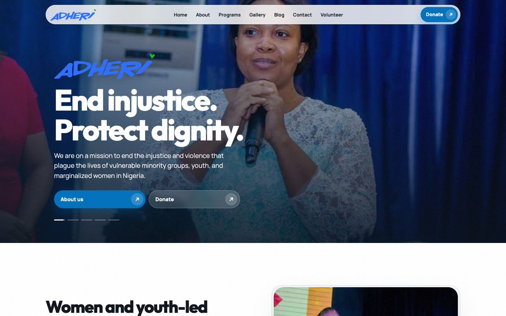

The organisation was on WordPress with a pile of plugins, a theme nobody could edit safely, and staff email that lived in three different places. I rebuilt it as one PHP application with three parts:

1. **Public site**: programs, gallery albums, blog, volunteer and contact forms, and donations through Flutterwave.
2. **Admin CMS** (`/admin`): staff manage every piece of content on the public site without touching code.
3. **ADHERI Mail** (`/mail`): Gmail-style webmail for `@advocatesforhealthandrights.org` addresses, with sending and receiving handled by [Resend](https://resend.com).

It runs on Namecheap shared cPanel hosting, so I had to work within those limits: no SSH workflow, no Node build step on the server, no queue workers, and no long-running processes. That ruled out most of what I'd normally reach for and shaped a lot of the decisions below.

---

## Stack

| | |
|---|---|
| Language | PHP 8.1+ (no framework, no Composer runtime dependencies) |
| Database | MySQL 8 / MariaDB 10.4+ |
| Web server | Apache with `mod_rewrite` (LiteSpeed in production) |
| Frontend | Server-rendered PHP templates, hand-written CSS, vanilla JS |
| Email | Resend API for transactional mail and the full webmail send/receive path |
| Payments | Flutterwave Standard (NGN) |

**Why no framework?** The host only gives FTP and a cPanel PHP selector. A Laravel install would have meant shipping `vendor/` over FTP on every deploy and fighting the host's PHP config. The app needs routing, a PDO wrapper, CSRF, sessions and templates. That's a few hundred lines I fully understand, with no upgrade treadmill. `composer.json` exists only for the PSR-4 autoload mapping, and the app ships its own autoloader so Composer isn't required on the server.

---

## Screens

### Public site

| Gallery index | Album |
|---|---|
| 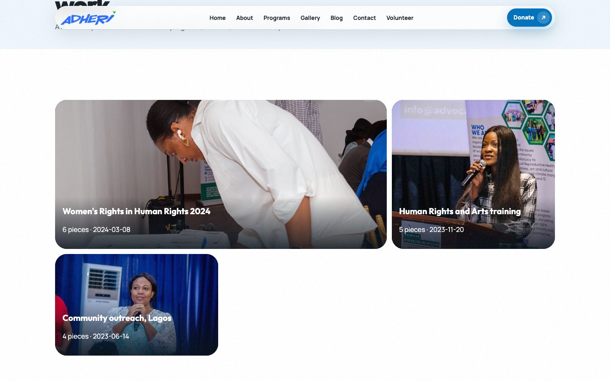 | 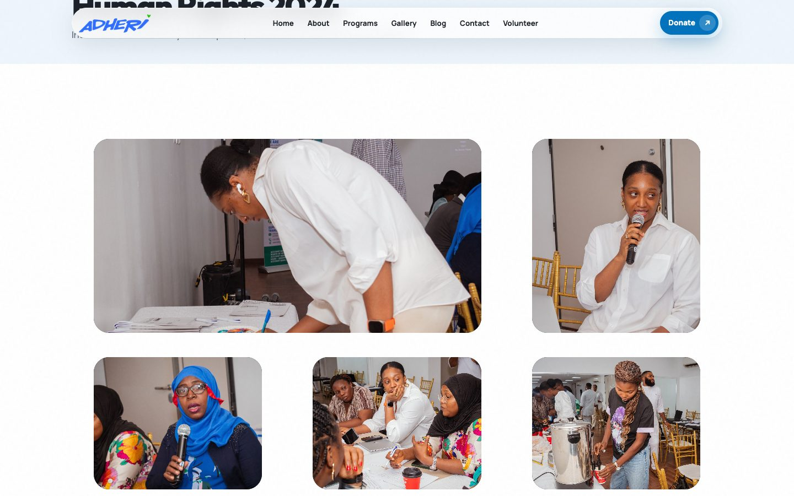 |

| Donate | Mobile |
|---|---|
| 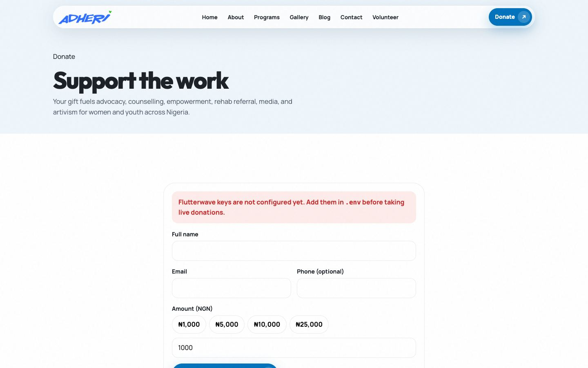 | 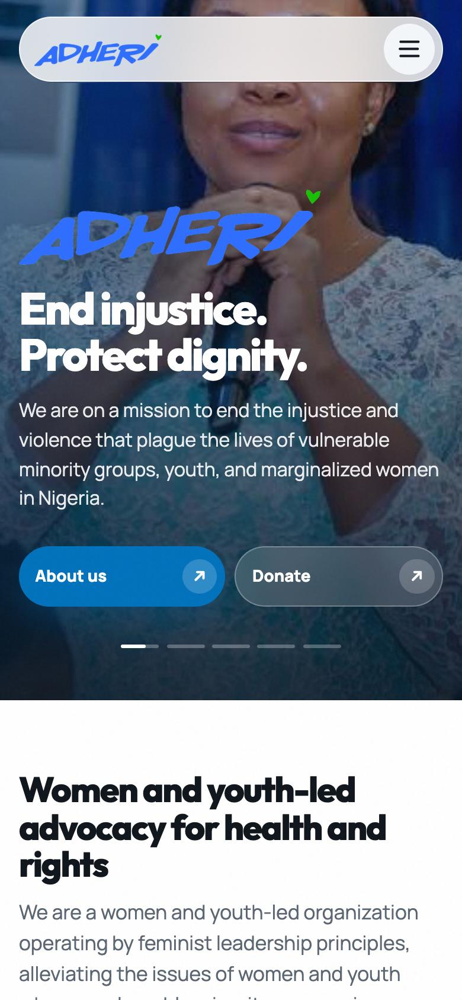 |

### Admin CMS

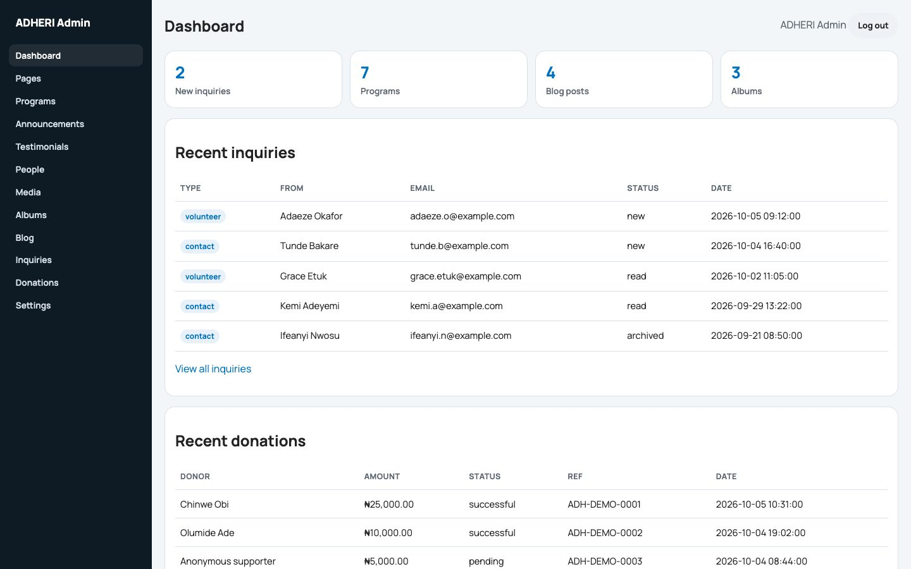

The album editor. Staff drop photos in, reorder them, add captions and pick the cover, all on one screen:

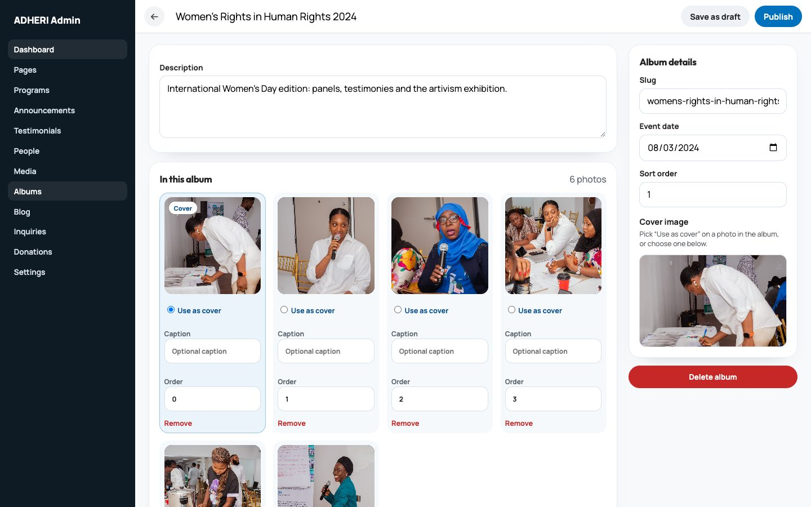

The blog editor is modelled loosely on Google Docs, because that's what the comms team already writes in:

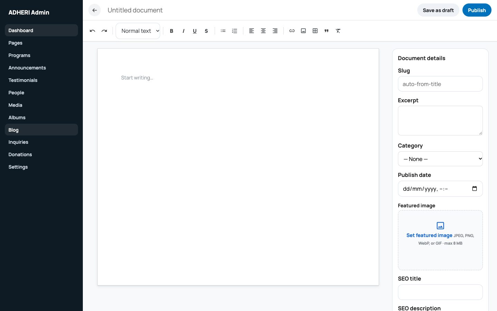

| Media library | Inquiries |
|---|---|
| 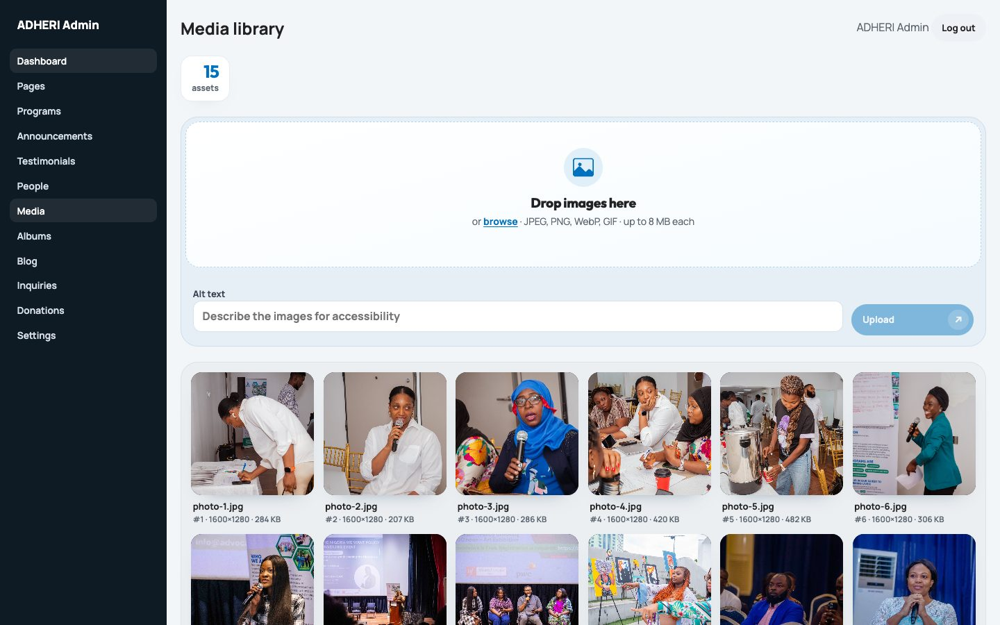 | 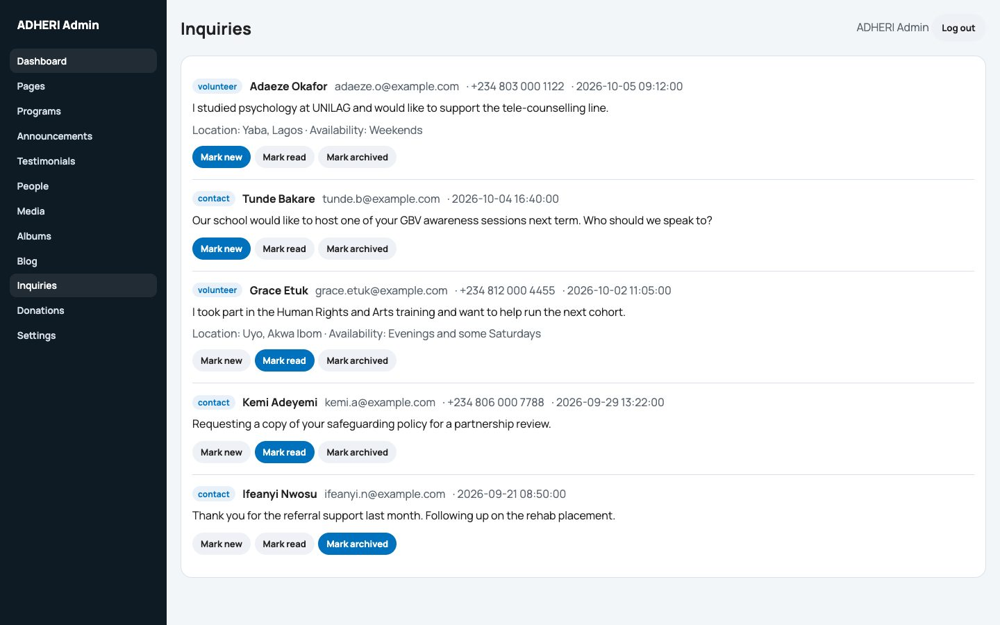 |

### ADHERI Mail

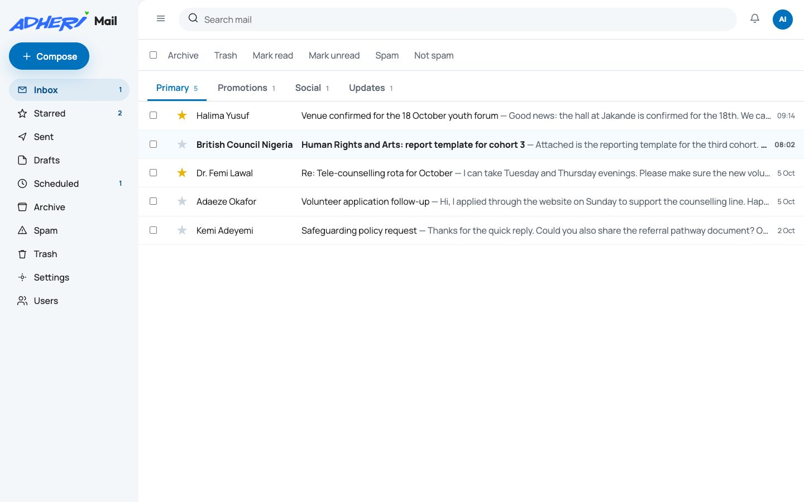

| Reading | Compose |
|---|---|
| 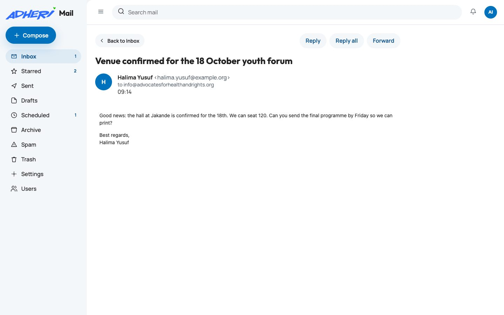 | 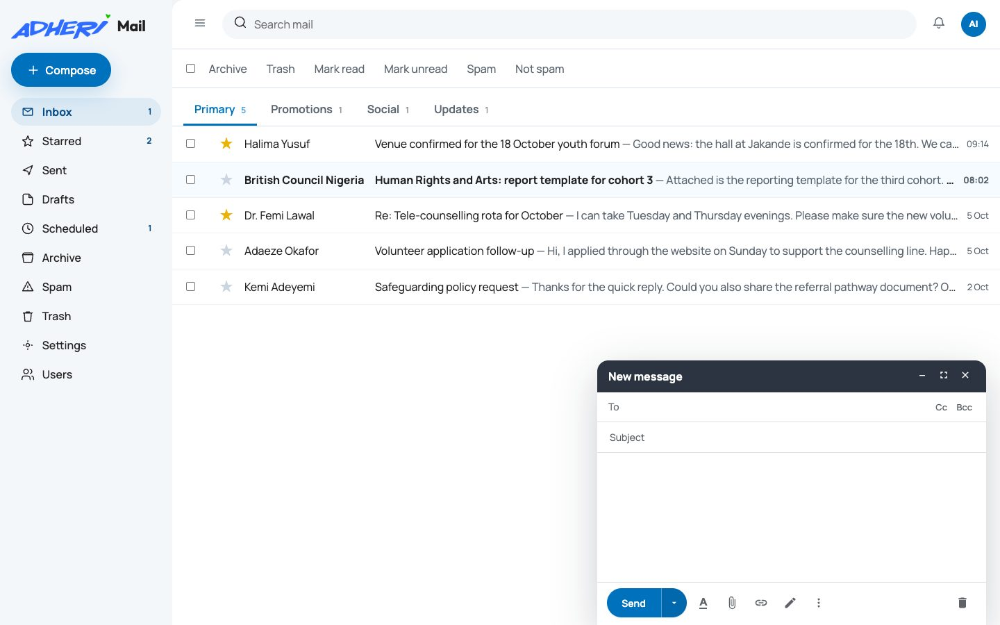 |

| Settings | Password recovery |
|---|---|
| 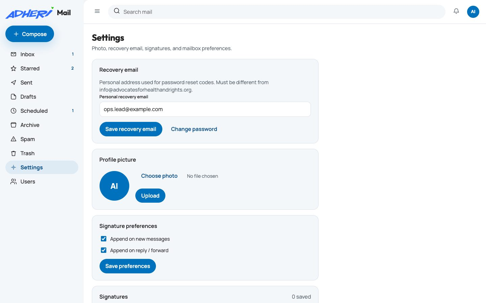 | 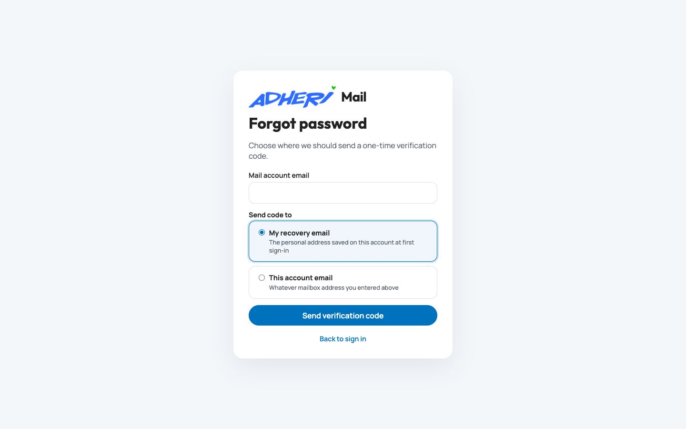 |

The admin and Mail screenshots were taken against a local copy of the database seeded with made-up people and messages. No real staff or donor data appears here.

---

## Project layout

```
app/
  bootstrap.php            autoloader, config, session, DB boot
  Router.php               method + path matching with {param} segments
  View.php                 renders a template inside a layout
  Database.php             thin PDO wrapper (prepared statements only)
  Http/
    Controllers/Admin/     one controller per CMS area
    Controllers/PublicSite/SiteController.php
  Modules/                 domain logic, one folder per concept
    Albums/ Announcements/ Auth/ Blog/ Content/ Donations/
    Inquiries/ Media/ Notifications/ People/ Programs/
    Sdgs/ Settings/ Testimonials/
  Mail/                    ADHERI Mail: service, session, Resend client, HTML sanitiser
  Security/                admin Auth + CSRF
  Support/                 Url, Str (escaping), Flash, Seo
public/                    web root (maps to public_html on the server)
  index.php                front controller for site + CMS
  mail/                    ADHERI Mail pages, routed extensionless by .htaccess
  webhooks/resend-mail.php inbound mail webhook
  api/mail/                token-protected setup + inbound sync endpoints
  assets/                  css, js, images
resources/views/           templates: layouts/, public/, admin/
routes/                    web.php (public), admin.php (CMS)
database/                  schema.sql, seed.sql, migrations/
scripts/                   CLI helpers (migrations, admin password, mail admin)
CONTEXT.md                 domain glossary and product scope
DESIGN.md                  visual direction and UI rules
```

Everything except `public/` sits one level above the web root in production, so `.env`, `app/` and `storage/` are never reachable over HTTP.

### How a request moves

`public/index.php` loads `app/bootstrap.php`, which registers the autoloader, reads `.env`, starts the session and connects to the database. The router matches the path against `routes/web.php` or `routes/admin.php` and calls a controller method.

Controllers stay thin. They read the request, call a module, and render a view. SQL lives in the module repositories (`AlbumRepository`, `PostRepository` and so on), never in controllers or templates. Templates escape everything through `Str::e()`.

`CONTEXT.md` defines the domain terms (Program, Album, Media, Post, Inquiry, Donation, RecoveryEmail, MailUser), and the code uses the same names. That sounds like a small thing, but it meant conversations with the client about "albums" and "inquiries" mapped directly onto tables and classes.

---

## Admin CMS

The CMS covers everything that used to require a WordPress plugin:

- **Pages**: editable sections on About, Home and so on, plus a per-page SEO title and description.
- **Programs**: one entry per program area (advocacy, counselling, artivism, climate change, rehab support and so on), each with a summary, body and featured image, and a flag for whether it shows on the home page.
- **Albums and media**: a central media library with drag-and-drop upload. Albums reference media rather than copying files, so one photo can sit in several albums.
- **Blog**: a rich-text editor with inline image upload, drafts, scheduled publish dates and categories.
- **People and testimonials**: board, team and youth ambassadors, and quote cards.
- **Announcements**: event flyers and calls for applications.
- **Inquiries**: contact and volunteer submissions with a new / read / archived workflow. Every submission is also emailed to the inquiry inbox through Resend.
- **Donations**: a log of every Flutterwave transaction and its status.
- **Settings**: site-wide values such as contact details and social links.

Uploads go through `MediaLibrary`. It checks the real MIME type with `finfo` (not the browser's claim), caps files at 8 MB, records dimensions, and stores everything under `public/uploads/` with a generated filename.

---

## ADHERI Mail

This is the part I'd point an engineer at first. Staff needed real mailboxes on the organisation's domain, and the hosting plan's built-in email kept landing in spam. Resend had already solved deliverability for the contact forms, so I built a webmail client on top of it.

It's deliberately separate from the CMS: its own users table (`mail_users`), its own session cookie (`mf_mail_session`), its own CSRF token and its own login. A CMS editor doesn't automatically get a mailbox, and a compromised mailbox doesn't get you into the CMS.

**Sending.** Compose posts to `send.php`, the HTML is passed through an allowlist sanitiser (`MailHtml`), attachments are staged on disk, and the message goes out through Resend's API. Large images are recompressed before sending, because most recipients are on mobile data.

**Scheduled send.** There's no cron on this plan that I'd trust. Instead, scheduled messages are handed to Resend with `scheduled_at` and Resend sends them at the right time. Cancelling a scheduled message calls Resend's cancel endpoint and moves the message back to Drafts.

**Receiving.** Resend's inbound routing posts to `/webhooks/resend-mail`. The webhook verifies the Svix signature (HMAC-SHA256 over `id.timestamp.body`, with a timestamp tolerance) before trusting anything, then fetches the full message and attachments from Resend's API and files them under the right mailbox. If a webhook is missed, `/api/mail/sync-inbound` (protected by a setup token) pulls recent inbound mail and back-fills the gaps.

**Rendering untrusted HTML.** Inbound HTML is shown inside an `<iframe sandbox>` built with `srcdoc` and without `allow-scripts`, so a hostile email can't run JavaScript in the app's origin.

**Inbox categories.** Inbound mail is sorted into Primary, Promotions, Social and Updates using sender-domain lists, automated local parts (`noreply`, `notifications`), `Auto-Submitted`, `List-Unsubscribe` / `List-Id` / `Precedence` headers and a few subject patterns. It's simple, it's right most of the time, and staff can move anything that's misfiled.

**Live updates.** The inbox polls `/mail/updates` every few seconds and returns only the newest message id and folder counts. WebSockets aren't an option on shared hosting, and polling with a tiny payload is cheap enough at this scale.

Also included: starring, archive, spam and trash, search, threads with reply-all and forward, multiple signatures with a default, avatars, and an admin page where mail admins create mailboxes for new staff. Logins are throttled to 8 failed attempts per 15 minutes per IP.

---

## Account recovery

Both the CMS and Mail have a "forgot password" flow built on the same service (`Modules/Auth/PasswordRecoveryService`), with a `realm` that tells them apart.

My first version sent recovery codes to the founder's personal inbox. That's wrong once there are more staff: the founder shouldn't be the reset desk for everyone, and staff shouldn't have to ask permission to get back into their own account. The current design:

- On first sign-in, every account is sent to an **account setup** page and can't go further until it saves a personal recovery email. It must be a different address from the account itself, otherwise losing the mailbox locks you out of recovering it.
- On the forgot-password page you choose where the code goes: your recovery email or the account email.
- The code is 6 digits from `random_int`, stored only as a hash, valid for 10 minutes, with 5 attempts and a 60-second cooldown between requests.
- A correct code issues a single-use reset token valid for 15 minutes. New passwords must be at least 12 characters.

The schema changes ship as SQL migrations, and the code also checks for the columns at runtime and adds them if missing. That's belt and braces, because on this host the database is often updated by hand through phpMyAdmin.

---

## Security notes

- Every state-changing form carries a CSRF token, checked with `hash_equals`.
- Sessions are `HttpOnly` and `SameSite=Lax`, and are regenerated on login and logout.
- Passwords use `password_hash` / `password_verify`.
- All SQL goes through PDO prepared statements.
- Uploads are checked by real MIME type and size, then renamed. Nothing user-supplied becomes a path.
- Secrets live only in `.env`, above the web root. No password is seeded: `database/seed.sql` creates the admin with an unusable hash, and you set the real one with `scripts/set-admin-password.php`, which reads it from STDIN.

---

## Running it locally

You need PHP 8.1+ with `pdo_mysql`, `curl`, `mbstring`, `fileinfo` and `gd`, plus MySQL or MariaDB and Apache. XAMPP or MAMP is the quickest way to get all of that on a laptop.

```bash
git clone https://github.com/Choboy-dev/adheri-platform.git
cd adheri-platform
cp .env.example .env            # fill in DB_* at minimum
```

Create the database and load the schema:

```bash
mysql -u root -e "CREATE DATABASE adheri CHARACTER SET utf8mb4 COLLATE utf8mb4_unicode_ci"
mysql -u root adheri < database/schema.sql
mysql -u root adheri < database/seed.sql
for f in database/migrations/2026_*.sql; do mysql -u root adheri < "$f"; done
php scripts/run-mail-migrations.php
php scripts/set-admin-password.php admin@advocatesforhealthandrights.org
```

Point Apache's document root at `public/` (or open the project as a subfolder under XAMPP's `htdocs`; `Url::base()` works out the prefix). Then:

- Site: `/`
- CMS: `/admin/login`
- Mail: `/mail/login`. Set `MAIL_ADMIN_EMAIL` and `MAIL_ADMIN_PASSWORD` in `.env` and run `php scripts/setup-mail-admin.php` to create the first mailbox.

Without `RESEND_API_KEY`, forms still save to the database but no email goes out. Without Flutterwave keys, the donate page shows a notice instead of the payment form.

The original event photography (around 200 MB) isn't in the repo. The gallery is driven by the database, so upload your own images through the CMS.

---

## Deployment

Production is cPanel over FTPES. `public/` goes to `public_html/`, and everything else goes to the account's home directory one level up. Because `app/bootstrap.php` resolves paths relative to itself, nothing needs rewriting between local and production.

Two things that bit me and are worth knowing if you deploy to similar hosting:

- **cPanel can silently change your PHP version.** The account was moved back to PHP 7.4 by a cPanel update, and the site started returning 500 on `str_starts_with`. The MultiPHP block that cPanel writes into `.htaccess` gets regenerated, so I added a second `AddHandler` line for PHP 8.1 outside the cPanel markers so a regeneration can't downgrade it.
- **`.env` isn't in `public_html`, and that's intended.** Staff opening File Manager kept asking where the config was. It's in the home directory, above the web root, which is the whole point.

---

## Known gaps

I'd rather list these than have someone find them:

- **The Flutterwave webhook doesn't verify the `verif-hash` header yet**, and doesn't re-query the transaction before marking a donation successful. `FlutterwaveGateway::verifyTransaction()` exists but isn't wired in. This has to be fixed before the live payment keys go in. Production currently has no Flutterwave keys, so no real money flows through it today.
- **No rate limiting on the CMS login.** Mail has it; the CMS doesn't yet.
- **The forgot-password form says when an email has no account.** With a dozen staff, a clear "no account for that address" saved more support messages than it cost. A public-facing product would get a uniform response plus per-IP throttling.
- **No automated tests.** Everything was checked by hand against a local copy and then smoke-tested on production. The repositories are thin enough that integration tests against a throwaway MySQL database would be the right first step.
- **`MailService` is about 2,000 lines.** It started as a single service and kept growing. It should be split into mailbox queries, compose/send, inbound processing and account management.
- **Mail live updates are polling.** That's fine for a handful of staff, but it wouldn't scale to hundreds of mailboxes.

---

## Author

Built and maintained by [Choboy-dev](https://github.com/Choboy-dev): architecture, backend, frontend and hosting.
